# 02 — FR8 Navigation Map & Architecture

```mermaid
flowchart TD
    ROOT[Root Shell / Bottom Navigation] --> TAB1[Tab 1: Book]
    ROOT --> TAB2[Tab 2: Trip]
    ROOT --> TAB3[Tab 3: Rates]
    ROOT --> TAB4[Tab 4: Support]
    ROOT --> TAB5[Tab 5: Account]

    %% Tab 1: Book
    TAB1 --> SCR01[SCR-01: My bookings]
    SCR01 -->|Filter Icon| SCR02[SCR-02: Bookings Filter Modal]
    SCR01 -->|Tap Expired Card| SCR03[SCR-03: Booking detail Expired]
    SCR03 -->|Book Button| SCR06[SCR-06: Book truck Form]
    SCR01 -->|Tap Allocated Card| SCR04[SCR-04: Trip detail Allocated]
    SCR04 -->|Show more| SCR05[SCR-05: Trip Timeline Bottom Sheet]
    SCR04 -->|Chat| SCR22[SCR-22: Support Chat]
    SCR01 -->|+ Book Pill| SCR06
    SCR06 -->|From / To| SCR07[SCR-07: City Search Overlay]
    SCR06 -->|Material type| SCR08[SCR-08: Material type Selector]
    SCR06 -->|Ton MT| SCR09[SCR-09: Tonnage Numeric Input]

    %% Tab 2: Trip
    TAB2 --> SCR10[SCR-10: Trip List Ongoing / POD Pending / POD Received]
    SCR10 -->|Search Icon| SCR17[SCR-17: Trip Search Overlay]
    SCR10 -->|Filter Icon| SCR18[SCR-18: Trip Filter Modal]
    SCR18 -->|Custom Date| SCR19[SCR-19: Date Range Picker]
    SCR10 -->|Tap Card| SCR11[SCR-11: Trip detail Delivered]
    SCR11 -->|Show more| SCR05
    SCR11 -->|Payments| SCR12[SCR-12: Payment details Sheet]
    SCR11 -->|Documents| SCR13[SCR-13: Documents Sheet LR / POD]
    SCR11 -->|Tracking| SCR14[SCR-14: Live Toll & Highway Tracking]
    SCR11 -->|Help| SCR15[SCR-15: Trip Help Issue Selector]
    SCR15 -->|Select Issue| SCR16[SCR-16: Get Help Bottom Sheet]

    %% Tab 3: Rates
    TAB3 --> SCR20[SCR-20: Instant Market Rates]
    SCR20 -->|Tap Lane Card| SCR21[SCR-21: Past Rates & Historical Chart Sheet]

    %% Tab 4: Support
    TAB4 --> SCR22[SCR-22: Support Tickets & Chat Interface]

    %% Tab 5: Account
    TAB5 --> SCR23[SCR-23: Account Hub]
    SCR23 -->|Bell Icon| SCR24[SCR-24: Notifications Inbox Novu]
    SCR23 -->|Tap Profile| SCR25[SCR-25: Edit Profile Sheet]
    SCR23 -->|Organization| SCR26[SCR-26: Organization Tax Details Sheet]
    SCR23 -->|Users| SCR27[SCR-27: Users Management Sheet]
    SCR27 -->|+ Add user| SCR28[SCR-28: Add User Form]
    SCR23 -->|Account Balance| SCR29[SCR-29: Virtual Bank Account Top-up]
    SCR23 -->|My Payments| SCR30[SCR-30: Reconciled Incoming Payments]
    SCR23 -->|Pending Payments| SCR31[SCR-31: Pending Invoices Payment]
    SCR23 -->|POD / Truck Tracking| SCR32[SCR-32: Direct Tracking Lookup Form]
    SCR32 -->|Submit Query| SCR33[SCR-33: Tracking Results & POD Download]
    SCR23 -->|Help| SCR34[SCR-34: Operations Call Support Sheet]
    SCR23 -->|Watch Videos| SCR35[SCR-35: Tutorial Video Library]
    SCR23 -->|Terms| SCR36[SCR-36: Legal Terms & Conditions WebView]
```

## Navigation Invariants

1. **Persistent Bottom Bar**: The 5-tab bar (`Book`, `Trip`, `Rates`, `Support`, `Account`) is visible on all primary tab screens.
2. **Sub-Screen Navigation**: When pushing into a sub-screen (`SCR-03`, `SCR-04`, `SCR-06`, `SCR-11`, `SCR-14`), the top bar replaces the tab title with a back arrow (`KEYCODE_BACK`), and the bottom navigation bar is hidden.
3. **Modals & Bottom Sheets**: All sheets (`SCR-05`, `SCR-12`, `SCR-13`, `SCR-25`, etc.) render on top with a semi-transparent backdrop (`#00000080`), drag handle, and dismiss on backdrop tap or drag down.
