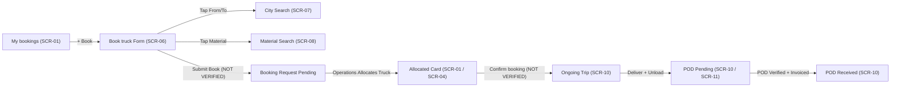

# 07 — Workflow Audit

End-to-end workflows documented directly from observed screens and transitions. Steps gated by irreversible/financial rules are explicitly marked where paused.

---

## Workflow 1: New Truck Booking Creation
- **WORKFLOW NAME**: Create Truck Booking Request
- **STARTING SCREEN**: `SCR-01` (`My bookings`)
- **USER ACTIONS**:
  - **STEP 1**: Tap `+ Book` pill button (`[1017, 222]`) on `SCR-01`.
  - **STEP 2**: `SCR-06` (`Book truck`) opens pre-filled with the last route/cargo (`Mappedu -> Vijayawada`, `Others`, `9 MT`, `32 Feet Single Axle`).
  - **STEP 3**: Tap `From` (`SCR-07`) -> type >= 4 characters (e.g., `"Chen"`) -> select city radio item (or tap a `Recent` pair). Repeat for `To`.
  - **STEP 4**: Tap `Material type` (`SCR-08`) -> search/select commodity radio item. Tap `Ton(MT)` (`SCR-09`) -> enter numeric weight.
  - **STEP 5**: Select desired truck body/size pill chip under `Open` / `Closed` / `Trailer` and optionally enter `Notes`.
  - **STEP 6**: Tap `Book` primary CTA *(paused before final tap per Phase 10)*.
- **RESULT**: *(Up to Step 5)* All inputs update inline; final submission `NOT VERIFIED`.
- **STATUS CHANGES**: `INFERRED` creates a new Booking card in `SCR-01`.
- **SCREENS INVOLVED**: `SCR-01`, `SCR-06`, `SCR-07`, `SCR-08`, `SCR-09`
- **VALIDATION**: City search requires >= 4 characters (`OBSERVED`); numeric keypad enforced on `Ton(MT)` (`OBSERVED`).
- **ERROR CONDITIONS**: Unverified (submission paused).
- **SUCCESS STATE**: `NOT VERIFIED` (booking creation stopped prior to submit).
- **SCREENSHOTS**: `008_book_truck_form.png` – `013_book_truck_tonnage.png`

---

## Workflow 2: Allocated Booking Inspection & Confirmation Entry
- **WORKFLOW NAME**: Inspect Allocated Truck & Enter Confirmation
- **STARTING SCREEN**: `SCR-01` (`My bookings`)
- **USER ACTIONS**:
  - **STEP 1**: Tap Allocated booking card (`#15309639 | TN20CQ6185 (SXL)`).
  - **STEP 2**: `SCR-04` (`Trip detail`) opens showing Traffic agent, Driver phone, `Chat`, and `Confirm booking`.
  - **STEP 3**: Tap `Show more` to inspect `SCR-05` (`Confirmed 25-Nov 20:37`, `TAT 1d`, `482km`, 10-stage stepper).
  - **STEP 4**: Tap `Chat` to jump to `Support` (`SCR-22`), or tap `Confirm booking` *(paused per Phase 10)*.
- **RESULT**: Detailed contact, route, and milestone inspection works seamlessly.
- **STATUS CHANGES**: `Allocated` -> `Confirmed` (`INFERRED` upon `Confirm booking`).
- **SCREENS INVOLVED**: `SCR-01`, `SCR-04`, `SCR-05`, `SCR-22`
- **SCREENSHOTS**: `001_initial.png`, `006_booking_detail_allocated.png`, `007_trip_detail_show_more.png`

---

## Workflow 3: Delivered Trip — Tracking, Documents, Payments & Help
- **WORKFLOW NAME**: Post-Delivery Trip Management
- **STARTING SCREEN**: `SCR-10` (`Trip` -> `POD Pending`)
- **USER ACTIONS**:
  - **STEP 1**: Open `Trip` tab -> tap `POD Pending` (`2`).
  - **STEP 2**: Tap trip card `#14720260` to open `SCR-11` (`Trip detail`).
  - **STEP 3**: Tap `Show more` -> inspect populated milestone timestamps (`Confirmed` through `PODVerified`).
  - **STEP 4**: Tap `Payments` (`SCR-12`) -> inspect itemized charges (`Freight`, `Unloading Charges`, `Unloading Halting`), NEFT payment log, and balance.
  - **STEP 5**: Tap `Documents` (`SCR-13`) -> inspect `Loading Memo`, `LR` (`Auto E-LR`, `Manual E-LR`, `E-way Bill`), `POD`, and `Invoice` billing address.
  - **STEP 6**: Tap `Tracking` (`SCR-14`) -> inspect route map, progress bar, ETA, E-way expiry, and toll plaza timeline.
  - **STEP 7**: Tap `Help` (`SCR-15`) -> pick issue type (`Payments`, `Delivery`, `POD`) -> inspect `Get Help` callback sheet (`SCR-16`, paused before `Request call back`).
- **RESULT**: All 4 operational quick actions open cleanly as dedicated sub-screens or bottom sheets.
- **STATUS CHANGES**: Read-only inspection; payment/callback submission skipped per Phase 10.
- **SCREENS INVOLVED**: `SCR-10`, `SCR-11`, `SCR-05`, `SCR-12`, `SCR-13`, `SCR-14`, `SCR-15`, `SCR-16`
- **SCREENSHOTS**: `015_trip_pod_pending.png` – `022_trip_help_payments_form.png`, `050_trip_delivered_timeline.png`

---

## Workflow 4: Market Rates & Historical Trend Lookup
- **WORKFLOW NAME**: Check Instant & Historical Freight Rates
- **STARTING SCREEN**: `SCR-20` (`Rates`)
- **USER ACTIONS**:
  - **STEP 1**: Open `Rates` tab (`Chennai -> Bangalore`, `~352 km`).
  - **STEP 2**: Browse 8 truck categories with current rate & range.
  - **STEP 3**: Tap `Past Rates →` on a truck card (`32 ft Container Truck (MXL)`).
  - **STEP 4**: Inspect `SCR-21` bottom sheet (`Book Truck →`, 6-month trend chart `Jun 26`–`Nov 26`, recent historical trips).
- **RESULT**: Immediate pricing benchmark and 6-month historical visualization displayed.
- **SCREENS INVOLVED**: `SCR-20`, `SCR-21`
- **SCREENSHOTS**: `029_rates_tab.png` – `032_rates_past_rates_detail.png`

---

## Workflow 5: Bulk POD / Truck Tracking Lookup
- **WORKFLOW NAME**: Multi-Truck POD Status Search
- **STARTING SCREEN**: `SCR-23` (`Account`) -> `POD/Truck tracking`
- **USER ACTIONS**:
  - **STEP 1**: Tap `POD/Truck tracking` (`SCR-32`).
  - **STEP 2**: Type or paste truck number(s) (`TN37DM2598`) into the auto-extract textarea; `Track` button activates.
  - **STEP 3**: Tap `Track` (`SCR-33`) to view truck chip, trip count (`1 trips`), and POD status (`Last status: Collection pending`).
- **RESULT**: Returns trip-level POD status for the entered truck number(s).
- **SCREENS INVOLVED**: `SCR-23`, `SCR-32`, `SCR-33`
- **VALIDATION**: `Track` button stays disabled (`#7F97B7`) when input is empty (`OBSERVED`).
- **SCREENSHOTS**: `044_account_pod_truck_tracking.png`, `045_account_pod_truck_tracking_result.png`

---

## Workflow 6: Organization User Management
- **WORKFLOW NAME**: View & Add Organization Sub-Users
- **STARTING SCREEN**: `SCR-23` (`Account`) -> `Users`
- **USER ACTIONS**:
  - **STEP 1**: Tap `Users` to open `SCR-27` bottom sheet showing existing users and `Admin` badge.
  - **STEP 2**: Tap `+ Add user` to open `SCR-28` (`Name`, `Mobile number`, `Add User` CTA — paused before submit).
- **SCREENS INVOLVED**: `SCR-23`, `SCR-27`, `SCR-28`
- **SCREENSHOTS**: `039_account_users.png`, `040_account_add_user.png`
