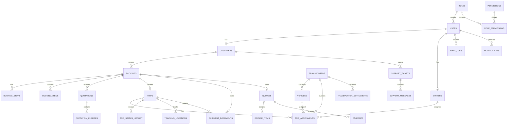

# Route NH - Entity Relationship Model (ERD)

## Relational Constraints & Business Invariants

1. **Conflict-Free Vehicle Dispatch**: A vehicle in status `ON_TRIP` cannot be allocated to another active trip until the current trip is `COMPLETED`.
2. **Conflict-Free Driver Allocation**: A driver with an active assignment cannot be assigned to another trip concurrently.
3. **Quotation Acceptance Invariant**: A booking cannot be confirmed without an accepted quotation. Customer acceptance automatically marks the quotation `ACCEPTED`, sets the booking to `CONFIRMED`, and creates an active `Trip` record.
4. **POD Verification Gate**: Trip completion requires delivery verification by the operations desk upon review of uploaded signed PODs.
